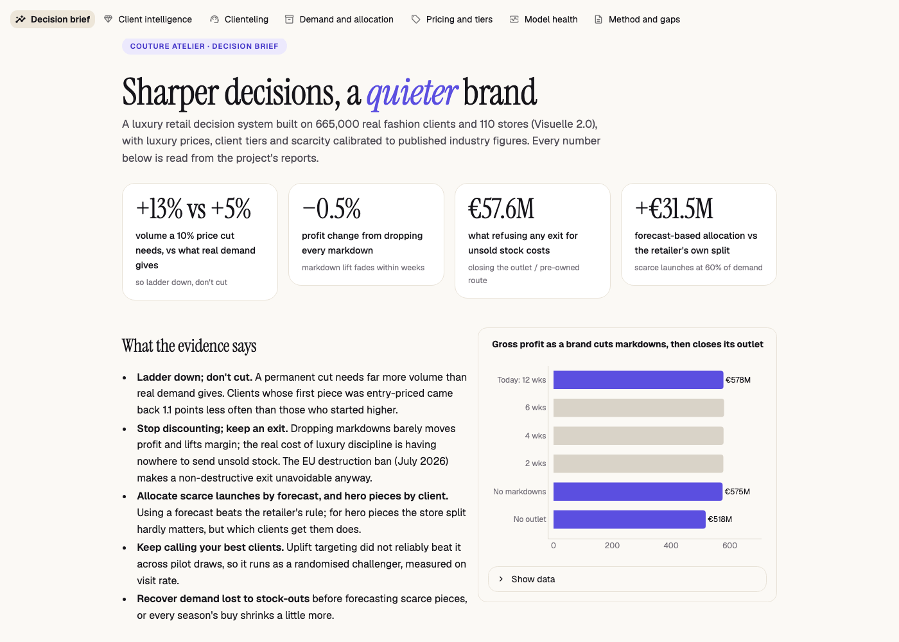

# Couture Atelier Intelligence

[](https://github.com/SanviNora/Couture-Atelier-Intelligence/actions/workflows/checks.yml)

A luxury retail decision system: which clients matter next year, whom each advisor should call, where scarce pieces should go, and whether a house should cut prices, ladder down or hold. It is built on **real behaviour from 665,000 fashion clients and 110 stores** (Visuelle 2.0) with luxury prices, client tiers and scarcity calibrated to published industry figures.

**Live dashboard:** _link added after deployment_



## Four decisions, four answers

| Decision | Answer | Evidence |
|---|---|---|
| **Cut prices, ladder down or hold?** | Ladder, don't cut | A 10% cut needs +13% volume to break even; real demand gives +5% once the markdown novelty fades (−€48M). Entry-first clients come back nearly as often (−1.1 points, same boutique and month). |
| **Keep discounting?** | Stop, but keep an exit | Dropping every markdown changes profit by −0.5%; refusing any exit for unsold stock costs about €58M (10%). |
| **Where do scarce pieces go?** | By forecast to boutiques, by relationship to clients | +€32M over the retailer's own split at 60% of demand; the hero-piece integer programme earns €67M vs €44M for "VICs first". |
| **Whom do advisors call?** | Their best clients; uplift runs as a challenger | Uplift models were unstable across pilot draws (82.9% vs 87.4% of the best achievable); a randomised challenger is designed, with a 5% client holdout. |

## What is real and what is modelled

| Real (Visuelle 2.0, 2016–2021) | Calibrated or simulated (every number in `configs/`) |
|---|---|
| Clients, visits, stores, weekly sales, discounts, restocks, product images | Luxury price ladder, VIC concentration (top 1% = 30% of revenue), trade-up, consent, advisors, contact effects, margins |

Raw data never leaves the machine. The dashboard reads only `public_bundle/`: aggregates, model outputs and synthetic examples, checked by an automated guard (no client identifiers, raw timestamps or groups under 10). See `docs/data_card.md`.

## How it is built

| Module | Method | Result on held-out data |
|---|---|---|
| Client value (`docs/client_intelligence.md`) | BG/NBD, MBG/NBD, Gamma-Gamma; gradient-boosting challengers chosen by rolling-origin validation; paired-bootstrap intervals | Return AUC 0.716 (+0.057 over recency); spend ranking +0.029 Spearman over last year's spend; holds in 9 of 9 luxury-layer calibrations |
| Clienteling (`docs/clienteling.md`) | T/S/X-learners, Qini with a stability-based trust check, champion vs challenger, power analysis with CUPED | Status quo 87.4% of the oracle; trusted uplift 82.9%; visual similarity adds +0.9 points on new launches |
| Demand (`docs/demand.md`) | Lost sales recovered from stock-outs (conditional expectation, EM), quantile gradient boosting | Launch WAPE 0.368 vs 0.469; 80% interval covers 79.0%; scarcity trap shown |
| Allocation (`docs/allocation.md`) | Negative-binomial greedy allocation, newsvendor, two-stage integer programme | See the table above |
| Pricing (`docs/tier_dial.md`, `docs/price_strategy.md`) | Staggered difference-in-differences with placebo, policy simulation, within-boutique cohort comparison | See the table above |
| Monitoring (`docs/dashboard.md`) | Population stability index, outcome monitoring | 6 of 8 inputs drifted before the 2019 spend bias; none before COVID |

Every data issue, shortcut and judgment call (81 so far) is logged in `docs/gaps_and_decisions.md` with what was done about it. Two examples: the 2019 spend bias was traced to a falling return rate (G75), and five sources of run-to-run drift were removed so repeated rebuilds now match by checksum (G76).

## Run it

```bash
pip install -e ".[dev]"
make all     # raw files -> SQL marts -> luxury layer -> every model -> public bundle (about 1 hour)
make select  # rerun model selection on pre-test data (about 30 minutes)
make app     # the dashboard, reading only public_bundle/
make test
```

Visuelle 2.0 must be downloaded separately (see `configs/data_sources.yml`); the dashboard and tests run from the committed public bundle without it. Architecture and how each piece maps onto a luxury house's stack: `docs/architecture.md`.

---

A portfolio project, not affiliated with Louis Vuitton, Chanel, LVMH or any other house, and not based on any company's private data.
