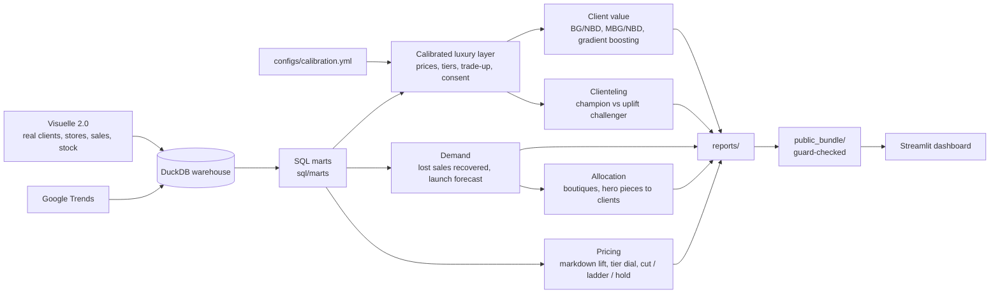

# Architecture

## Layers

| Layer | Where | What it guarantees |
|---|---|---|
| Raw and staging | `scripts/ingest_visuelle.py`, `scripts/ingest_google_trends.py` | Raw files are never edited; every table carries a provenance column |
| Marts | `sql/marts/01–06` | One grain per table; returns split from sales; stock rebuilt per store and week with sell-out weeks flagged |
| Luxury layer | `scripts/build_luxury_layer.py`, `configs/calibration.yml` | Every receipt value depends only on visits before it (no look-ahead); every number cited or labelled as an assumption |
| Models | `scripts/build_*.py`, `src/couture_atelier/` | Selected on pre-test data, tested once; frames rounded so rebuilds are bit-identical |
| Reports | `reports/` | Plain JSON and CSV; every dashboard number is read from here |
| Public bundle | `scripts/build_public_bundle.py` | Aggregates, model outputs and synthetic rows only; groups under 10 and client identifiers are blocked before publishing |
| Checks | `tests/`, `.github/workflows/checks.yml` | Lint, unit tests and the bundle guard on every push |

`make all` rebuilds everything from the raw files; `make select` reruns model selection (about 30 minutes).

## How this would run at a luxury house

The project runs on one laptop, but each piece maps onto a typical house stack:

| Here | At a house |
|---|---|
| DuckDB + SQL marts | The same SQL as dbt models on BigQuery or Snowflake, scheduled daily |
| `lux.client_value`, `lux.clienteling_actions` | Scores written back to the CRM (for example Salesforce Data Cloud) as client attributes and a next-best-action list per advisor |
| Champion vs challenger in `reports/clienteling.json` | A randomised A/B test in the clienteling app, read on visit rate with CUPED (5% client holdout or 17% of advisors) |
| `drift.csv` and the model-health page | Monthly input PSI plus weekly predicted-vs-realised visits and spend, with the fallback rule written down |
| Hero-piece integer programme | Run per drop by merchandising before allocation is released to boutiques |
| Advisor notes | Drafted by the house's model platform, published only after the same fact check, always editable by the advisor |
| Streamlit | The house BI tool (Power BI, Looker) for the standing views; the app for scenario work |
